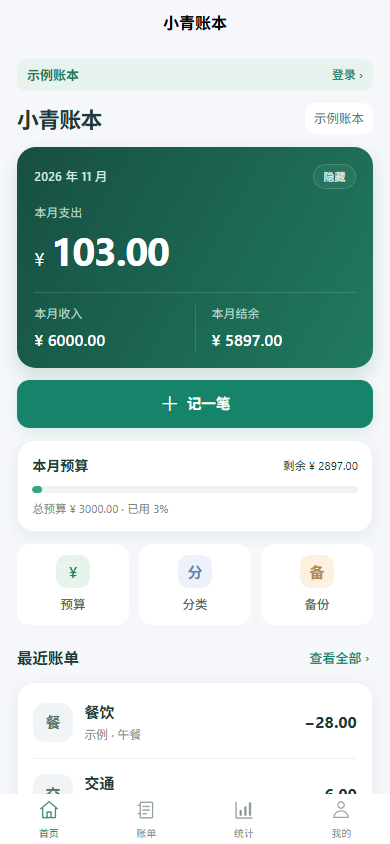
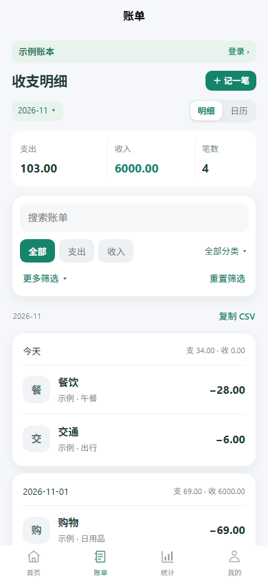
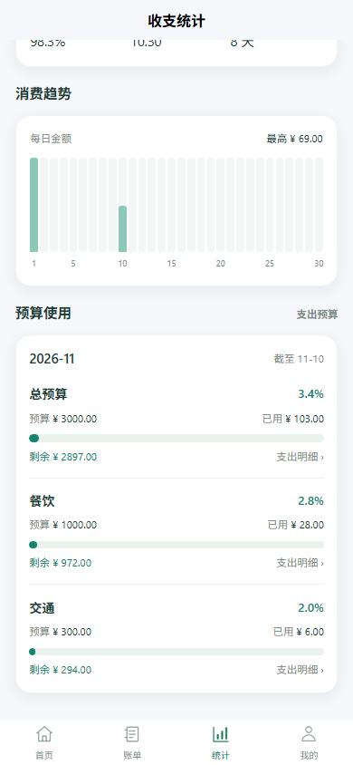
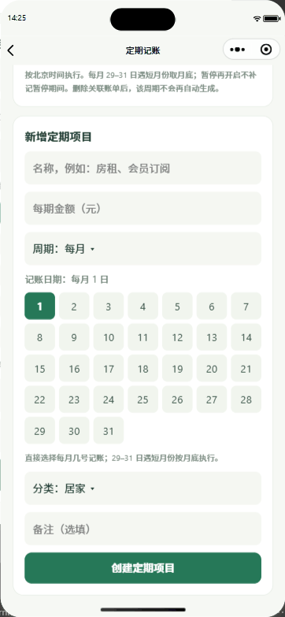

<p align="center"></p>
<h1 align="center">Xiaoqing Ledger</h1>
<p align="center"><b>Record daily spending. Keep your books in sync.</b><br />A WeChat bookkeeping mini program built with uni-app, Vue 3 and TypeScript.</p>
<p align="center"><a href="README.md">简体中文</a> · <b>English</b> · <a href="docs/releases/v1.0.5.md">v1.0.5 release notes</a></p>
<p align="center">
  <a href="#whats-new-in-v105"></a>
  <a href="LICENSE"></a>
  <a href="https://developers.weixin.qq.com/miniprogram/dev/framework/"></a>
  <a href="https://uniapp.dcloud.net.cn/"></a>
  <a href="https://vuejs.org/"></a>
  <a href="https://www.typescriptlang.org/"></a>
</p>
<p align="center"><a href="#screenshots">Screenshots</a> · <a href="#demo">Live demo GIF</a> · <a href="#features">Features</a> · <a href="#getting-started">Getting started</a> · <a href="#deploying-cloud-development">Cloud deployment</a></p>
<p align="center">Version 1.0.5 · Refreshed interface · Budget usage bars</p>

<a name="screenshots"></a>
<h2 align="center">A look inside</h2>
<p align="center">Mobile-sized H5 screenshots of the 1.0.5 sample ledger.</p>
<table align="center" width="100%">
  <tr>
    <td width="33%" align="center" valign="top"><h3>Home overview</h3><p>Monthly income, expenses, budget and recent records.</p></td>
    <td width="33%" align="center" valign="top"><h3>Transaction records</h3><p>Filters, search and a calendar view.</p></td>
    <td width="33%" align="center" valign="top"><h3>Budget usage</h3><p>Spending, remaining funds and overspending for each budget.</p></td>
  </tr>
</table>

<a name="demo"></a>
<h2 align="center">Choose a day. Repeat every month.</h2>
<table align="center" width="100%">
  <tr>
    <td width="36%" align="center" valign="middle"><br /><sub>Monthly day selection in an earlier version</sub></td>
    <td width="64%" valign="top">
<h3>Set a schedule in three steps</h3>
<ol><li><b>Choose a cycle</b><br />Monthly or weekly, for recurring expenses such as rent or subscriptions.</li><li><b>Select the date</b><br />Tap 1–31 in the monthly grid. Dates beyond the month length use its last day.</li><li><b>Enter the amount and category</b><br />Create the rule; the cloud scheduler checks due rules every five minutes after its trigger is deployed.</li></ol>
<h3>Keep one entry per period</h3>
<ul><li>Link a manual expense to the rule to prevent duplicate automatic records.</li><li>Pause a rule, or delete it while keeping historical entries.</li><li>Schedules create ledger records, not actual payments.</li></ul>
<p><b>More than recurring entries</b><br />Switch between personal and group books, share group budgets, review trends, and export JSON or CSV backups.</p>
<p><a href="#getting-started">Set up your own instance →</a></p>
    </td>
  </tr>
</table>
The interface is in Simplified Chinese; this README provides English setup and usage instructions.

---

**Latest Windows download: 1.0.5.** [Download the Windows x64 installer, quickstart and SHA-256 checksums](https://github.com/JackieYangon/xiaoqing-ledger/releases/tag/v1.0.5), or read the [release notes](docs/releases/v1.0.5.md). The installer is unsigned. Access to the trial mini program requires trial membership.

## What's new in v1.0.5

- A consistent green theme, cards, spacing and numeric hierarchy refresh the mini program's home, records, statistics and profile pages.
- Static explanatory prose is removed across the mini program, while action labels, necessary status messages, validation and confirmations remain.
- A single budget card lets you select a total or category budget and view its limit, spending, remaining amount or overspending, and actual usage percentage.
- The yearly cashflow chart combines monthly income and expense lines with balance bars. Empty months keep their labels and break the lines, future months are hidden, and negative balances appear below zero.
- Yearly budget views preserve each month's limits without creating an annual budget. The current month counts through today; future months are marked as not started. Budget rows for started months open the matching expense records.

See [missing app.json troubleshooting](#missing-appjson-at-the-project-root) and [sign-in troubleshooting](#sign-in-troubleshooting) for setup issues.

## Features

- **Explore before signing in:** first launch without a saved login opens the home page with a sample ledger. Try recording entries, filtering bills, statistics, budgets and category management without signing in. Trial edits remain only in memory for the current app session and never become part of an account's ledger. After you choose to sign in, later launches verify and restore the same account automatically.
- **Account sign-in and cloud sync:** choose to sign in when you want your personal cloud ledger, shared books, recurring records or backup tools. Ownership is verified on the server. Sign in to the same account on another phone to retrieve synced records.
- **Optional profile:** no phone number is required. Avatars and nicknames are optional, saved only after your explicit choice and confirmation, and are not required for bookkeeping. New records retain a snapshot of their author's profile. Names cannot be used to impersonate another account.
- **Personal and group ledgers:** switch books from the profile page. Personal records are not automatically shared. Group members see shared records and their authors, and can edit or delete their own entries. The creator manages shared budgets, categories and imports.
- **Group invitations:** join through a WeChat share card or a 16-character invitation code. Invitations expire after seven days; generating a new invitation invalidates the previous one. Limits: 20 members per group and 20 groups per account. Members can leave; creators can delete an empty group with no rules or other members.
- **Fast entry:** income and expense categories, arithmetic amounts such as `18.5+6-2`, a numeric keypad, note suggestions, and save-and-add-another. Existing records can be copied as new entries.
- **Records and calendar:** combine monthly, custom-date or all-date views with type, historical category, keyword and inclusive amount filters. Search categories, notes and authors; sort by date or amount and export filtered CSV. Calendar totals support backdated entry. The mini program and desktop share the filtering rules.
- **Budgets:** monthly total and category budgets, remaining amounts and overspending indicators on both clients. Copy the previous month's budget into a draft or fill the total from category limits, then save explicitly. Historical categories are retained. Daily allowance divides the remaining total by days left including today; future months use the full month and past months have no daily allowance.
- **Statistics:** monthly/yearly summaries and trends, savings rate, daily average expenses and days without recorded expenses. The mini program shows horizontal usage bars for monthly total and category budgets with links to matching expense records; desktop statistics retain category rankings and the five largest entries. Current periods compare through today's calendar date against the corresponding date in the previous period, clamped at month end; historical periods compare complete periods. Future-dated entries are excluded from current-period statistics. Savings rate is undefined without income; a day without recorded expenses does not establish that no spending occurred. Hiding amounts affects the home page only.
- **Editable categories:** every category can be renamed or deleted, including the initial categories. Up to 50 categories per income/expense type. Historical entries and existing category budgets retain their original labels. Renaming updates recurring rules; deletion pauses affected rules. Empty category lists remain empty until a category is added.
- **Recurring records:** weekly or monthly schedules, with a 1–31 day grid for monthly rules. Short months use the last day for dates beyond their length. Rules use Beijing time and do not backfill periods before creation. This creates bookkeeping entries, **not actual payments**. Up to 50 rules per ledger.
- **Explicit deduplication:** link a manual expense to its recurring rule. Only one entry is kept per book/rule/period. A manual entry prevents automatic creation; a later manual entry updates an automatically generated one. Unlinked entries are not deduplicated by guessing from amount or category.
- **Pause and delete rules:** resume without backfilling the paused period. Deleting a rule stops future generation and preserves existing entries. Only its creator or the group creator may manage a group rule. A departed member's rules are paused by the scheduler. Deleting a linked entry preserves its period marker so it is not recreated automatically.
- **Backup and export:** JSON backup validation and merge, plus CSV export. Existing entry IDs are skipped on import and current budgets are preserved. CSV is for export, not restoration.

## Getting started

Requirements: Node.js 20+, pnpm, WeChat Developer Tools, and your own mini program AppID and Cloud Development environment.

```powershell
pnpm install --frozen-lockfile
if (!(Test-Path -LiteralPath .env.local)) { Copy-Item .env.example .env.local }
# Set XQ_APP_ID and XQ_CLOUD_ENV in .env.local to your own values.
pnpm setup:local
pnpm dev:mp-weixin
```

After compilation, import the **repository root** into WeChat Developer Tools and click Compile. Keep the development terminal running. The generated `project.config.json` points to `dist/dev/mp-weixin/`.

Set `XQ_APP_ID` and `XQ_CLOUD_ENV` to your own deployment identifiers in the local, untracked `.env.local` file. Local process environment variables can also supply these values. Keep actual deployment values out of commits, release notes and screenshots. Do not enter an AppSecret in the frontend. `.env.local` and generated deployment files are ignored by Git:

- `project.config.json`
- `src/manifest.json`
- `src/config/cloud.local.ts`
- `cloudfunctions/ledger/local-config.json`

Edit shared settings in `project.config.template.json` and `src/manifest.template.json`. Development and build commands generate local configuration automatically. After changing manifest settings, restart the development build.

The application version comes from `package.json` (`version`). The profile page, generated manifest and desktop installer use this value. Rebuild and upload after changing it; existing development output and the phone's trial package do not update merely because the version file changed.

Windows shortcuts are also available:

```powershell
.\dev.ps1
.\dev.ps1 -Target h5
```

The helper uses pnpm from PATH, with a fallback to the local Codex runtime if available; it does not modify system environment variables. H5 supports guest browsing and sample-ledger edits for the current app session, but does not support account sign-in or access to cloud ledgers. A Windows desktop installer is available; QR sign-in depends on a separately configured HTTPS gateway.

## Checks and builds

```powershell
pnpm test
pnpm type-check
pnpm build:mp-weixin
pnpm build:h5
```

Production output is written to `dist/build/mp-weixin` and `dist/build/h5`. Do not edit generated files. The mini program build automatically checks that the main package is below 1,500,000 bytes, component injection is enabled with `requiredComponents`, and each image/audio asset is at most 200,000 bytes. WeChat Developer Tools remains the final authority for its upload checks.

The mini program build also sets the root project's `miniprogramRoot` to `dist/build/mp-weixin/`, so the repository root can be imported for preview after a successful build. Running `pnpm dev:mp-weixin` switches it back to `dist/dev/mp-weixin/`. Setup and type checks preserve the selected directory.

### Missing app.json at the project root

If the project reports a missing `app.json`, run `pnpm install --frozen-lockfile` followed by `pnpm build:mp-weixin` in the directory containing `package.json`. Confirm that `dist/build/mp-weixin/app.json` exists, then reopen the project and compile. `setup:local` repairs configuration only; it does not generate the mini program. Do not create an empty `app.json` by hand.

When `XQ_APP_ID` is absent, setup preserves an AppID already entered in the local project. Process environment values take priority over `.env.local`, then the existing AppID; an explicitly empty value selects guest mode. Account access and cloud sync still require your own cloud configuration and deployment.

### Sign-in troubleshooting

If sign-in reports that the cloud environment is missing, verify that your local `.env.local` contains the intended `XQ_APP_ID` and `XQ_CLOUD_ENV`. The selected environment must contain the deployed `ledger` cloud function. A preserved AppID alone does not supply a cloud environment, and editing `.env.local` does not update code that has already been compiled.

1. Check the two local values and any overriding process environment variables. Keep them in local configuration; do not paste actual deployment identifiers into public issues or release notes.
2. Stop the development compiler if it is running, then run `pnpm build:mp-weixin` from the directory containing `package.json`. For ongoing development, restart `pnpm dev:mp-weixin` instead and wait for compilation to finish.
3. Reopen the repository root in the developer tools and compile. Confirm that `miniprogramRoot` points to the output of the command you just ran: `dist/build/mp-weixin/` for a production build or `dist/dev/mp-weixin/` for development.
4. If the same missing-environment message remains after a successful rebuild, clear **only the compilation cache** in the developer tools, then compile and try signing in again. A stale compilation cache can retain the earlier bundle with an empty environment value. Preserve application storage and user data; do not use a clear-all-data action to resolve this build issue.
5. If sign-in still fails, inspect the current error and the `ledger` function logs in the configured environment. Confirm that the project AppID and deployed function configuration match your own deployment. H5 supports guest browsing only and cannot be used to verify account sign-in.

Clearing the compilation cache is separate from clearing the mini program's local storage. Local storage can contain unmigrated legacy records, pending requests and remembered sessions; keep it intact during this procedure.

### Uploading the trial mini program

Sign in to WeChat Developer Tools and provide the actual CLI path on your machine:

```powershell
pnpm upload:mp-weixin --cli "C:\YOUR_PATH\cli.bat"
# Rebuild and prepare the upload project without uploading
pnpm upload:mp-weixin --prepare-only
```

Every upload runs a fresh production build and package checks, then creates a new project under `work/wechat-release/` and copies `dist/build/mp-weixin` into its `miniprogram/` directory. It takes the upload version from `package.json` and requires both a CLI success result and a fresh receipt. It does not upload the repository root's potentially stale development output. The CLI path can also be set with the `XQ_WECHAT_CLI` environment variable.

Both upload and `--prepare-only` validate that an AppID and cloud environment have been configured before building the release project. Fill in your own local deployment values first. To check this configuration explicitly, run `node scripts/prepare-local-config.cjs --mp-mode build --require-cloud`. Ordinary development and build commands remain available for guest previews without cloud configuration.

After uploading, confirm the version in the mini program console and select that development version as the trial version. Reopen the trial mini program on your phone and check the version on the profile page. GitHub Releases and WeChat trial versions are separate publication channels. Generated upload projects and receipts in `work/` are not committed to Git.

Documentation images live in `docs/images/`, outside `src/static/`, and are not included in the mini program package.

## Deploying Cloud Development

1. Create `xq_books`, `xq_entries` and `xq_requests` in your own cloud environment. Set all three to **administrator-only read/write**. Clients access data through cloud functions, not directly.
2. Run `pnpm build:cloud` to prepare local configuration and generate shared validation code.
3. Right-click `cloudfunctions/ledger` in WeChat Developer Tools and upload/deploy with dependencies installed in the cloud. Choose your own environment. Include the generated `local-config.json`, or set the cloud function environment variable `XQ_APP_ID`. A missing AppID causes requests to be rejected rather than bypassing identity validation.
4. Set the function timeout to **20 seconds** and confirm it is active.
5. Compile and sign in. Check the cloud sync page before relying on another device to retrieve records.

For entry pagination, create an ascending compound index on `xq_entries.owner` and `_id` if prompted. Changing the AppID or cloud environment requires updating `.env.local`, rebuilding and redeploying.

### Background scheduler

`cloudfunctions/ledger/config.json` defines a timer named `ledgerRecurring` with the expression `0 */5 * * * * *` (every five minutes).

After deploying the function, right-click **`cloudfunctions/ledger/config.json` → Upload Trigger** in WeChat Developer Tools. Some versions expose the action on the function folder. Verify execution logs in the cloud console; uploading code alone does not confirm that the timer is active. The app displays the most recent background check when available. A manual due-date check is also available for the selected book.

The entry point checks the trusted runtime source `wx_trigger`; client event fields cannot authorize global scheduler execution. Do not expose the function through an anonymous HTTP endpoint.

Each invocation processes up to 20 due rules and advances their next date after a successful transaction. Concurrent execution and manual checks share the same deduplication markers. Monitor runtime, failures and backlog as usage grows. Suggested recurring-query indexes include `type`, `active`, `nextDate`, and, for scoped checks, `scope`.

## Identity, privacy and data safety

- First-time guests can open the home page and try entries, filters, statistics, budgets and categories without automatic sign-in or profile authorization. The sign-in page also offers a return to browsing. Automatic restoration applies only after a previous voluntary sign-in.
- Trial data exists only in memory for the current app session. It does not read legacy local bills or account caches and is never imported into the personal ledger when signing in. No phone number is required; avatars and nicknames are optional.
- Trusted OPENID/APPID and a valid session are required for cloud ledger operations. Client-supplied account fields cannot replace server-side identity.
- A dedicated local login record stores only the session credential, account identifier and expiry, with no bills or profile details. Server sessions last up to 24 hours. Later launches and foreground checks verify the remembered identity and renew expired sessions only for the same account. Temporary network failures retain the login record, hide account data and offer a connection retry.
- Signing out removes the local login record, clears in-memory account data and filters, and returns to guest browsing without deleting cloud records or other devices' sessions. Deleting the mini program's local storage also removes its remembered login; this differs from clearing the developer tools' compilation cache. An identity change clears the previous account state and requires a new voluntary sign-in. Login-storage failures display an error without modifying existing bills.
- The app processes account identifiers, voluntarily provided profile details, entries, budgets and group membership. Shared book entries and author details are visible to group members. Open-source licensing does not authorize access to users' data.
- Avatar uploads accept PNG/JPEG, are compressed by the client and checked by the server, with a size limit of roughly 200 KB. Storage paths are assigned on the server, and temporary display URLs are returned. Old avatar files are retained for historical records. Automated profile/avatar content moderation is not currently included.
- `xq_books` stores books, profiles, groups and recurring rules. `xq_entries` stores records. `xq_requests` stores sessions, idempotency receipts, invitations and period markers. Do not delete `cycle_` markers: doing so can allow a deleted periodic entry to be recreated.
- This repository contains no maintainer deployment identifiers. Never commit `.env.local`, AppSecret, access tokens, private keys, account exports or personal screenshots. Never put service credentials in frontend environment variables.

## Backups, migration and limits

Legacy local data remains under `xiaoqing.ledger.v1`; schema 1/2 is supported. Export a copy first, then explicitly migrate it to the signed-in personal account from the sync page. Migration does not delete the original local data. Confirm successful sync before changing phones.

Imports run in batches of up to 20 entries. Retrying skips existing IDs and preserves current budgets/settings; a failure may occur after earlier batches have succeeded. Cross-book imports attribute entries to the importing user and remove recurring-rule associations. Pending requests remain isolated by environment, account and book, and can be retried after reconnecting. Concurrent edits require refreshing and reconfirming instead of overwriting another device's changes. Offline entry creation in account ledgers is not supported.

Amounts are stored as integer cents. JSON exports include entries, categories and budgets, but not group membership, invitations, recurring rules or profile configuration. Limits: 50,000 entries and 2,000,000 characters per JSON backup. Backups are not encrypted. Cloud storage is not a substitute for independent backups; clearing local storage may discard unmigrated data and pending requests.

## Desktop development and deployment

The desktop client uses a separate interface and shares amount calculations, categories, filtering, budgets, statistics, synchronization and conflict handling with the mini program. It supports personal and group books, calendar views, filtered CSV exports, copied entries and recurring rules. Profile editing and complete JSON backup restoration remain in the mini program.

```powershell
pnpm install --frozen-lockfile
pnpm test
pnpm build:desktop-gateway
pnpm desktop
pnpm package:desktop
```

Desktop development and packaging require Node.js 22.12 or later. Set `XQ_DESKTOP_API_URL` in your local `.env.local` to the HTTPS URL of your separately deployed desktop gateway before packaging. Generated `release/` files and local configuration are not committed. The Windows installer is unsigned; packaging commands themselves do not publish it.

Deploy `ledger` and the separate `desktop-gateway` in the same cloud environment. Expose only `desktop-gateway` through an HTTPS gateway; keep the original `ledger` function off anonymous HTTP endpoints. Configure `XQ_WECHAT_APP_SECRET` only in the gateway's server-side environment, never in `.env.local`, source files, the installer or a chat message. The server must be able to reach the required platform APIs and satisfy their IP allowlist settings.

Desktop sign-in obtains a one-time mini program code. Scan it on a phone, compare the six-digit code shown on both devices and explicitly confirm sign-in. The desktop then receives a separate, short-lived session for the same account and books. Set `XQ_MINI_ENV` to `release`, `trial` or `develop`, and ensure that the corresponding mini program version includes `pages/desktop-login/index`.

For trial testing, upload the mini program containing that page, make it available to trial users, set `XQ_MINI_ENV=trial` locally, run `pnpm build:desktop-gateway` and redeploy the gateway. After the mini program is publicly released, switch to `release`, rebuild and redeploy. Server-side environment variables take precedence over generated local configuration. Release codes validate page availability; trial and development codes target their respective code versions.

Configure gateway rate limits and quotas for unauthenticated requests. The function's additional global code-generation limits are 30 requests per minute and 500 per day, using UTC windows; these do not replace gateway protection. Gateway failures return the operation stage and numeric error code rather than raw platform error text or credentials.

## Project structure

| Path | Purpose |
| --- | --- |
| `src/core/ledger.ts` | Amounts, validation, compatibility, categories, budgets, backup merging and summaries |
| `src/core/cloud-client.ts` | Pagination, pending writes and recovery |
| `src/services/auth.ts` | Sign-in, session validation and protected navigation |
| `src/services/ledger.ts` | Shared ledger state, cloud operations and book switching |
| `src/pages/` | Mini program screens |
| `src/components/BillList.vue` | Entry and author display |
| `cloudfunctions/ledger/` | Trusted identity, transactions, group access and recurring processing |
| `scripts/` | Local configuration, shared-code generation and package checks |
| `tests/` | Data integrity, cloud isolation, authentication and feature tests |
| `docs/images/` | Public README screenshots and GIF |

The initial scaffold comes from [uni-preset-vue/vite-ts](https://github.com/dcloudio/uni-preset-vue/tree/vite-ts). Navigation PNGs are committed; regenerate them with `python scripts/build-icons.py` in a Python environment with Pillow installed.

## License

Original project code is licensed under [MIT](LICENSE). Preserve its copyright and license notice when redistributing the software or substantial portions of it. The software is provided without warranty.

Third-party dependencies retain their own licenses: the direct uni-app packages use Apache-2.0; Vue, vue-i18n and wx-server-sdk use MIT. Preserve their applicable notices and license texts when distributing third-party code. Neither this license nor public source availability grants access to user data.
