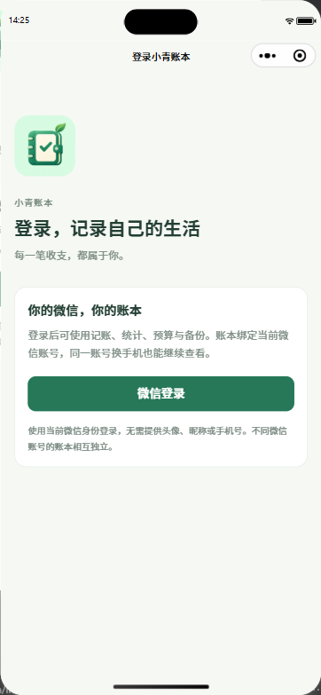
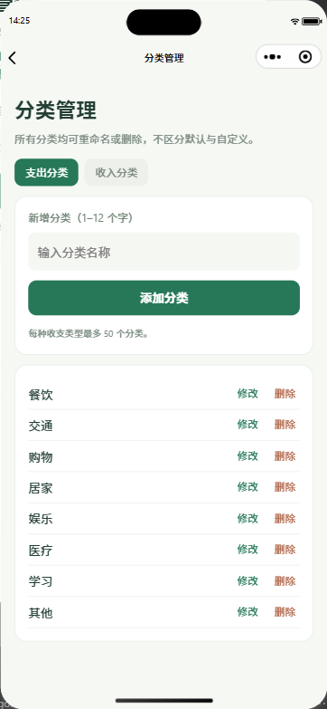
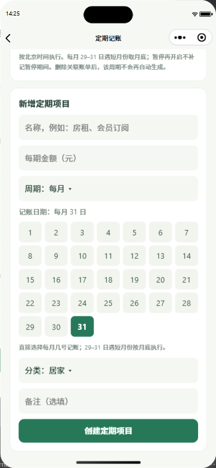
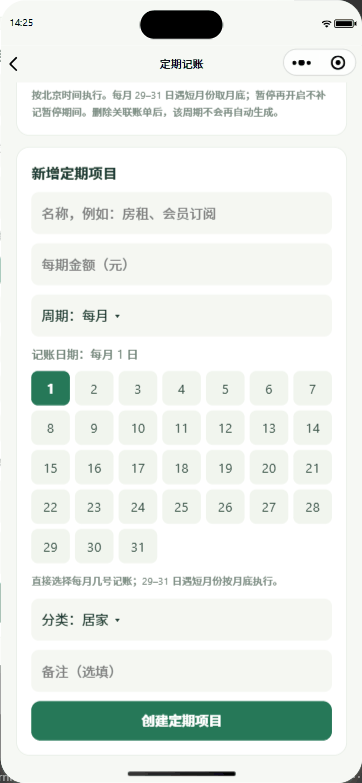

<p align="center"></p>
<h1 align="center">小青账本</h1>
<p align="center"><b>把日子，记清楚。</b><br />基于 uni-app、Vue 3 和 TypeScript 的微信记账小程序。</p>
<p align="center"><b>简体中文</b> · <a href="README.en.md">English</a></p>
<p align="center">
  <a href="#101-主要功能"></a>
  <a href="LICENSE"></a>
  <a href="https://developers.weixin.qq.com/miniprogram/dev/framework/"></a>
  <a href="https://uniapp.dcloud.net.cn/"></a>
  <a href="https://vuejs.org/"></a>
  <a href="https://www.typescriptlang.org/"></a>
</p>
<p align="center"><a href="#screenshots">界面预览</a> · <a href="#demo">操作演示</a> · <a href="#101-主要功能">功能介绍</a> · <a href="#启动">快速开始</a> · <a href="#微信云开发">云端部署</a></p>
<p align="center">版本 1.0.1 · 个人 / 群组账本 · 云端同步 · 定期记账</p>

<a name="screenshots"></a>
<h2 align="center">界面预览</h2>
<p align="center">从微信登录到分类管理，再到每月自动记账。</p>
<table align="center" width="100%">
  <tr>
    <td width="33%" align="center" valign="top"><h3>微信登录</h3><p>微信身份登录，云端同步账本。</p></td>
    <td width="33%" align="center" valign="top"><h3>分类管理</h3><p>所有分类统一管理，支持修改与删除。</p></td>
    <td width="33%" align="center" valign="top"><h3>定期记账</h3><p>日历式网格点选每月记账日期。</p></td>
  </tr>
</table>

<a name="demo"></a>
<h2 align="center">点选一天，每月自动记录。</h2>
<table align="center" width="100%">
  <tr>
    <td width="36%" align="center" valign="middle"><br /><sub>每月日期选择演示</sub></td>
    <td width="64%" valign="top">
<h3>三步设置定期记账</h3>
<ol><li><b>选择周期</b><br />支持每月或每周，适用于房租、订阅等固定支出。</li><li><b>点选日期</b><br />在 1–31 日网格中直接选择；短月份自动按月底执行。</li><li><b>填写金额与分类</b><br />创建项目并部署触发器后，云端每 5 分钟检查到期任务。</li></ol>
<h3>同一周期，只记一笔</h3>
<ul><li>手动记账关联定期项目，避免自动重复记录。</li><li>支持暂停和删除任务，保留历史账单。</li><li>定期记账仅生成账单，不发起真实扣款。</li></ul>
<p><b>日常记账也齐全</b><br />个人与群组账本切换、群组共享预算、收支趋势统计，以及 JSON / CSV 数据导出。</p>
<p><a href="#启动">部署自己的小青账本 →</a></p>
    </td>
  </tr>
</table>
<p align="center"><sub>实际小程序界面截图；GIF 按步骤播放日期选择过程，没有创建或删除账单。</sub></p>

界面目前为简体中文，英文 README 提供英文使用与部署说明。素材未包含真实头像、昵称、账单明细、邀请码或部署标识；`docs/images/` 不进入小程序安装包。

---

电脑端下载见 [GitHub Releases](https://github.com/JackieYangon/xiaoqing-ledger/releases)。v1.0.1 电脑端为体验测试版，需要微信体验权限；发布说明见 [v1.0.1](docs/releases/v1.0.1.md)。

## 1.0.1 主要功能

- **微信资料**：「我的」点击头像/昵称进入资料页，选择头像并使用微信昵称填写框，确认后保存。账号唯一性仍由微信身份决定，昵称不能用来切换或冒用账号。资料保存后，新账单记录当时的记账人资料。
- **账本切换**：「我的 → 切换账本」选择个人或已加入群组。首页、账单、统计和预算都随账本切换，记账页显示当前账本。个人记录不会自动共享；旧本地迁移仅允许迁入个人账本。
- **群组**：「我的 → 群组与账本」创建或加入。群主生成有效期 7 天的邀请，可用微信分享卡片或 16 位邀请码加入；重新生成会使旧邀请失效。成员能看群组账单和记账人，只能修改/删除自己的记录；群主管理共享预算、分类及批量导入。成员退出后失去访问权，历史记录保留。群主暂不能退出；没有账单、定期项目和其他成员时可删除空群组。每个群组最多 20 名成员，每个账号最多加入 20 个群组。
- **定期记账**：每个账本最多 50 个项目，支持每周与每月。每月 29–31 日遇短月份按月底执行，使用北京时间；从创建当日或下一次到期日开始，不追溯创建前的月份。定时任务每 5 分钟检查到期项目，生成账单而非真实扣款；「立即校验到期项目」可补偿处理已到期项目。
- **周期去重**：手动保存时显式关联定期项目，以「账本 + 项目 + 周期」保证唯一。手动先记则自动跳过；自动先生成则手动更新同一记录。普通未关联账单不会仅凭金额/分类被合并。删除关联账单保留周期标记，避免自动恢复；暂停再开启不补记暂停期间。群组定期项目为群组共用，创建者退出后自动暂停。
- **导航图标**：首页、账单、统计、我的均提供普通与选中两套图标。

## 功能

- **快速记账**：分类选择、金额加减计算（如 `18.5+6-2`）、自定义数字键盘、常用备注建议、保存并再记、复制历史账单再记一笔。
- **收支明细**：按日分组，月份、类型、分类及备注搜索；日历显示每日收支，选中日期可补记。
- **预算管理**：每月独立总预算及分类限额，剩余预算、进度和超支提示。空金额表示不设限，分类限额不自动分摊总预算。
- **统计**：月度/年度收支、结余、记录天数、每日/每月趋势、分类排行、前五笔大额记录。月度分类可点击查看明细。
- **分类管理**：所有分类统一管理，可重命名和删除，每种收支类型最多 50 个。历史账单和已有分类预算保留原名；重命名同步更新定期任务，删除会暂停引用该分类的任务。
- **备份恢复**：完整 JSON 复制、校验预览、确认合并；兼容 v0.1 备份，重复导入不会重复入账，相同 ID 保留当前账本版本。已有月份预算、隐私设置不覆盖。
- **CSV 导出**：复制全部或指定月份账单的 CSV 文本，保存为 UTF-8 `.csv` 后可用 Excel 打开；不支持用 CSV 恢复。
- **首页金额隐藏**：隐藏首页总额、预算金额和最近账单金额，并记住开关；其他页面仍可查看明细。

## 启动

需要 Node.js 20+ 和 pnpm。使用 `pnpm-lock.yaml` 锁定依赖。

```powershell
pnpm install --frozen-lockfile
pnpm dev:mp-weixin
```

等待编译完成后，在微信开发者工具导入**项目根目录**。`project.config.json` 中 `miniprogramRoot` 指向 `dist/dev/mp-weixin/`；开发期间保持编译终端运行。

AppID 和云环境从未跟踪的 `.env.local` 生成。请填写自己的部署标识；共享设置修改 `src/manifest.template.json` 和 `project.config.template.json`，不要编辑生成文件或填写 AppSecret。

Windows 也可使用快捷脚本；它优先使用 PATH 中的 pnpm，再尝试本机 Codex 自带的 pnpm，不改系统环境变量：

```powershell
.\dev.ps1
.\dev.ps1 -Target h5
```

H5 预览可用 `pnpm dev:h5`，地址以终端显示为准。微信真机验证仍需在开发者工具完成。

## 检查与构建

```powershell
pnpm test
pnpm type-check
pnpm build:mp-weixin
pnpm build:h5
```

生产产物在 `dist/build/mp-weixin`，可单独导入开发者工具；H5 产物在 `dist/build/h5`。不要直接修改 dist 文件。

### 快速复查包体质量

已有构建产物时，可以单独检查主包大小、组件按需注入和图片／音频资源上限，无需重新构建：

```powershell
pnpm check:mp-quality
# 检查当前开发预览包
node scripts/check-mp-quality.cjs dist/dev/mp-weixin
```

检查失败会返回非零退出码，便于接入 CI。修改源码或配置后应先重新构建，避免误查旧产物；上传结果仍以微信开发者工具的检查为准。

## 微信登录与用户归属

首次打开或冷启动进入「微信登录」页，登录后才能访问全部业务页面。登录使用云函数可信 OPENID/APPID；不要求头像、昵称、手机号或 AppSecret。「我的」与记账页显示当前微信账号的简短标识，账单所属账号由服务端计算，客户端不能指定他人的账本。

会话凭证仅保存在内存，最长有效 24 小时；退出或冷启动后需重新点击登录。回到前台时重新验证身份。退出登录清空内存账本和筛选状态，并撤销当前会话；其他设备的会话与云端记录保留。网络中断时仍立即清空本机登录态，服务端残余会话到期失效，且只能由同一微信身份使用。

登录会话与幂等回执共用 `xq_requests` 集合，session_ 前缀文档存储归属和到期时间，不存储原始凭证。所有账本接口必须同时满足可信微信身份和有效会话校验。请求中的 owner、accountId 不能替代服务端身份。待确认写入仍按环境和账号隔离，退出不删除，重新登录后可恢复确认。已有账单的 owner 算法不变，无需再次迁移云端记录。

## 微信云开发

小程序连接环境 `YOUR_CLOUD_ENV`，通过 `ledger` 云函数访问数据库。身份由云函数运行上下文的 OPENID 和 APPID 确定，客户端不能指定他人的账本。账单、预算、分类及金额隐藏设置同步到当前微信账号。

部署步骤：

1. 在云开发中创建 `xq_books`、`xq_entries`、`xq_requests` 三个集合，权限均设为「仅管理员可读写」。客户端禁止直接读写集合，仅通过云函数访问。
2. 执行 `pnpm build:cloud`，生成云函数共用的数据校验代码。
3. 在开发者工具右键 `cloudfunctions/ledger`，选择「上传并部署：云端安装依赖」，目标环境选择上述 ID。
4. 将 `ledger` 超时设为 **20 秒**，确认状态为 Active。
5. 编译小程序，在「我的 → 云同步」确认连接成功。换手机后使用同一个微信账号打开同一个小程序，即可加载该账号账本。

查询使用 `xq_entries` 的 owner 条件与 _id 升序分页。数据量增长或控制台提示缺少索引时，为此集合建立 owner 升序、_id 升序的复合索引。

更换环境或 AppID 请修改未跟踪的 `.env.local` 并运行 `pnpm setup:local`，重新构建并部署云函数。无需填写 AppSecret。

## 定时触发器部署

`cloudfunctions/ledger/config.json` 包含名为 `ledgerRecurring` 的 timer 配置，cron 为 `0 */5 * * * * *`。上传云函数代码之后，还需在微信开发者工具右键 **`cloudfunctions/ledger/config.json` → 上传触发器**（部分版本在 ledger 文件夹菜单中）。在云开发控制台确认触发器存在且有执行日志，才能保证小程序关闭时自动生成账单。入口严格校验微信注入的 SOURCE 为 wx_trigger，普通客户端无法伪造定时器事件执行全局任务；不要将该函数配置为匿名 HTTP 接口。

任务每次最多处理 20 个到期项目，事务成功后推进 nextDate，积压任务在后续触发继续处理。并发任务和客户端手动补记使用相同的周期标记，写入与预算相关计数保持原子性。大量项目时应监控执行时间、失败日志和积压，并相应扩大处理能力。

继续使用原有三个仅管理员可读写集合：xq_books 保存账本、profile_ 用户资料、group_ 群组和 rule_ 定期项目；xq_entries 保存账单；xq_requests 保存会话、幂等回执、invite_ 邀请和 cycle_ 周期标记。不能随意删除 cycle_ 文档，否则会破坏去重语义。定期查询建议为 xq_books 建立 type、active、nextDate 升序复合索引；按账本校验可再增加 scope 字段。现有个人账本 ID 不变，旧账单保持可读。

头像由客户端压缩后交给已登录云函数上传，仅接受 PNG/JPEG、最大约 200KB；存储路径由服务端按账号生成，返回受限时效的预览地址。更换头像保留旧文件以支持历史账单，不要批量删除 avatars 目录。资料与头像目前不包含自动内容审核，公开发布前应结合使用范围配置必要的审核流程。

## 数据与升级

微信小程序必须登录后才能使用，以云端账本为准；网页 H5 只显示登录提示，不提供本地账本入口。电脑端 EXE 目前提供开发测试版本；扫码登录仍需要单独部署并配置电脑端 HTTPS 网关，完成真机端到端验收后才可正式使用。

旧版数据仍保留在 `xiaoqing.ledger.v1`，支持 schema 1/2。在「我的 → 云同步」先复制旧本地备份，再确认「迁移」到当前微信账号。迁移不会自动执行，也不会删除原本地数据。换手机前必须确认旧记录已经迁移并显示同步成功。

云端导入每批最多 20 笔，相同 ID 跳过，已有预算和隐私设置保留；中断可能已完成部分批次，重新导入会去重。网络不确定时保留待确认请求，恢复连接后用同一请求 ID 确认结果，防止重复入账。并发修改发生冲突时要求同步后重新确认，不覆盖另一台设备的修改。当前不支持离线新增账单。

金额按整数分保存。JSON 导出包含当前账本的账单与预算，不含群组成员、邀请、定期规则或个人资料配置。跨账本导入将记账人归为当前导入用户，清除定期项目关联，避免冒用他人身份。JSON 备份上限 200 万字符，账单上限 50000 笔，分类每种最多 50 个。云端保存不等于独立备份，建议定期导出 JSON；备份文件未加密，请妥善保管。清除本地存储会移除尚未迁移的旧账本和待确认请求，因此应先完成同步与备份。

## 代码结构

- `src/core/ledger.ts`：金额计算、校验、旧版兼容、预算/分类、备份合并、统计与 CSV。
- `src/services/ledger.ts`：云端/本地适配、共享状态与导航。
- `src/components/BillList.vue`：账单列表展示。
- `src/pages/`：首页、明细/日历、记账、统计、预算、分类、数据备份和我的。
- `tests/ledger.test.cjs`：数据完整性、金额、预算、分类、升级、备份、日历边界测试。

- `src/services/auth.ts`：微信登录、会话校验、页面拦截和退出。
- `cloudfunctions/ledger/features.js`：群组权限、用户资料、周期算法及定时处理。
- `tests/features.test.cjs`：群组隔离、共享预算、资料归属、定期去重、并发重试及日历边界。
- `tests/auth.test.cjs`：登录拦截、退出清理、账号切换及旧请求竞态测试。
- `src/core/cloud-client.ts`：同步分页、持久化待确认请求及恢复。
- `cloudfunctions/ledger/`：可信微信身份、事务、并发控制及幂等写入。
- `tests/cloud.test.cjs`：模拟数据库的隔离、事务回滚、分页、迁移及请求恢复测试；不能替代真实云环境验收。

模板来源：https://github.com/dcloudio/uni-preset-vue/tree/vite-ts

图标 PNG 已提交，无需额外生成。需要修改图标时可在安装 Pillow 的 Python 环境运行 `python scripts/build-icons.py`。

## 开源许可证

本项目原创代码采用 [MIT License](LICENSE)，保留现有版权声明。允许使用、修改、分发和商业使用；分发代码或其重要部分时须保留版权声明和许可文本。软件按现状提供，不作担保。

选择 MIT 是为了保持应用代码的使用和分发条款简洁。Apache License 2.0 包含明确的专利授权及相关终止条款，本项目目前继续沿用 MIT，不因使用 Apache-2.0 依赖而更改原创代码的许可。

第三方依赖仍遵循各自许可证：直接依赖中的 uni-app 相关包使用 Apache-2.0，Vue、vue-i18n 和微信云开发 wx-server-sdk 使用 MIT。分发第三方代码时应保留对应许可证、版权声明及适用的 NOTICE；本项目的 MIT 许可证不替代第三方许可要求，也不授权访问用户账单、头像等个人数据。

## 本地部署配置与公开仓库

首次克隆后执行：

```powershell
pnpm install --frozen-lockfile
Copy-Item .env.example .env.local
# 在 .env.local 填入自己的 XQ_APP_ID 和 XQ_CLOUD_ENV
pnpm setup:local
```

`.env.local`、`project.config.json`、`src/manifest.json`、`src/config/cloud.local.ts` 和 `cloudfunctions/ledger/local-config.json` 均为本地文件，不提交 Git。构建及开发命令会自动从本地环境生成配置；共享配置请修改 `project.config.template.json` 和 `src/manifest.template.json`。云函数部署前先执行 `pnpm setup:local`，将生成的云函数本地配置一起部署，或在云函数环境变量中设置 `XQ_APP_ID`。缺少 AppID 时云函数拒绝业务请求，不会跳过身份校验。

AppID 和云环境 ID 是路由标识，不是访问密钥，但公开仓库不包含维护者的实际部署值。不要提交 AppSecret、访问令牌、私钥、云服务密钥、账单导出或包含个人信息的截图；不要将密钥写入任何前端环境变量。历史提交中的信息不会因普通删除提交消失，历史清理与密钥轮换需单独处理。

## 电脑端开发与部署（待验收）

电脑端由 Electron 和独立 Vue 页面构成，复用账本金额、分类、同步与并发校验。打开电脑端后获取一次性小程序码，手机在小程序确认并核对六位数字，电脑获得独立、短期有效的云端会话；关联同一小程序账号和群组账本。电脑端目前支持账单、总预算、分类、群组、定期项目；分类预算编辑、资料修改、账单备份导出等仍需小程序端操作。

```powershell
pnpm install --frozen-lockfile
pnpm test
pnpm build:desktop-gateway
pnpm desktop
pnpm package:desktop
```

Electron 45 开发与打包需要 Node.js 22.12 或更高版本。桌面窗口的请求只连接 `.env.local` 中 `XQ_DESKTOP_API_URL` 指定的 HTTPS 网关；打包前配置该地址，再重新执行 `pnpm package:desktop`。生成的 `release/` 和本地配置均不提交到 Git。安装包为未签名测试版。

部署前需：①在相同云环境部署更新后的 `ledger` 和独立的 `desktop-gateway`；②只为 `desktop-gateway` 创建 HTTPS 网关，禁止将原 `ledger` 云函数暴露为匿名 HTTP；③仅在云函数服务端环境变量配置 `XQ_WECHAT_APP_SECRET`，不要填写到 `.env.local`、仓库、安装包或聊天消息中；④按小程序代码版本设置 `XQ_MINI_ENV` 为 `release`、`trial` 或 `develop`，并确保对应版本已包含 `pages/desktop-login/index`；⑤在网关层配置按来源限流和配额，保护未登录接口免于滥用。云函数另对二维码生成设全局限额（每分钟 30 次、每天 500 次，按 UTC 时间窗口），但全局限额无法代替网关防护，且可能因恶意请求造成其他用户暂时无法获取登录码。服务端需能访问微信接口，且满足微信接口的 IP 白名单等平台配置。

将网关 URL 作为 `XQ_DESKTOP_API_URL` 配置在本机 `.env.local` 后构建安装包。AppSecret 只属于服务端，不要发送给他人。完整验收应使用两台真实设备与两个微信账号，验证登录确认、取消/过期/重放、账号和群组隔离、写入去重、网络中断恢复、退出及小程序已有账本兼容。模拟测试不等于真实云端验收。

电脑扫码联调时，先上传包含 `pages/desktop-login/index` 的小程序代码并设为体验版，在本机 `.env.local` 设置 `XQ_MINI_ENV=trial`，运行 `pnpm build:desktop-gateway` 后重新部署网关。正式发布后改为 `release` 并重新构建部署。若云端已有同名环境变量，它会优先于本地生成的配置。正式版登录码会校验页面存在；开发／体验版按对应版本生成，不依赖正式版中是否已有该页面。网关只返回微信接口错误的阶段与数字错误码，不返回原始错误文本、访问令牌或密钥。
